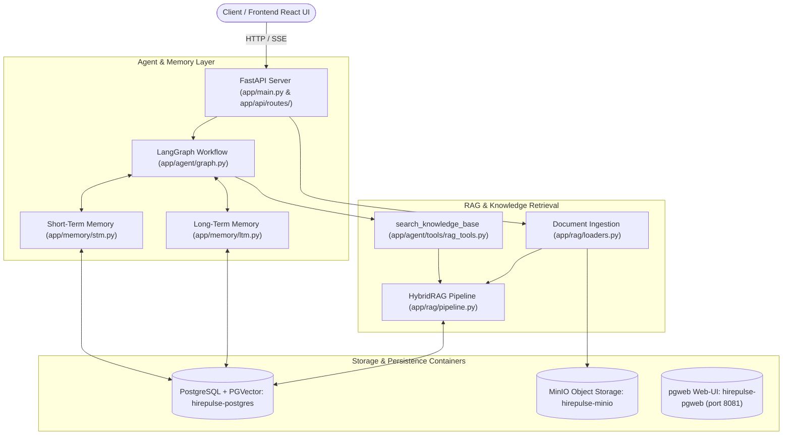

# HirePulse: Project Status & File-by-File Architecture Specification

**HirePulse** is an agentic AI-driven career assistant, resume optimizer, and job hunter. The system integrates **FastAPI**, **LangGraph**, **Hybrid RAG (ChromaDB + BM25 + FlashRank)**, and dual-tier conversational memory (**STM + LTM**). This document provides an exhaustive, file-by-file reference detailing the current state, functionality, architecture, and roles of every file across the codebase.

---

## 🏗️ System Overview & High-Level Flow

---

## 📂 Detailed File-by-File Breakdown

### 1. Configuration & App Factory (`app/`)

#### [app/config.py](file:///home/prime/PRIME/Chatbot/app/config.py)
* **Purpose**: Single source of truth for runtime configurations, filesystem paths, API keys, and environment variables.
* **Key Components**:
  * `BASE_DIR`, `DB_DIR`, `PERSIST_DIR`, `DOCS_DIR`: Resolves absolute paths for ChromaDB persistence and file uploads, automatically creating missing directories.
  * `POSTGRES_USER`, `POSTGRES_PASSWORD`, `POSTGRES_HOST`, `POSTGRES_PORT`, `POSTGRES_DB`, `DATABASE_URL`: PostgreSQL connection parameters.
  * `ALLOWED_EXTENSIONS`: Whitelist of supported document extensions (`.pdf`, `.csv`, `.md`, `.markdown`, `.txt`, `.json`, `.py`, `.log`).
  * `MAX_FILE_SIZE`: Restricts uploaded files to 25 MB.
  * `OPENR_API`, `GEMINI_API`, `OPENAI_API_KEY`: API keys loaded via `python-dotenv`.
  * `MODEL_NAME`: Set to `deepseek/deepseek-chat` via OpenRouter.
  * `OPENROUTER_BASE_URL`: Defaults to `https://openrouter.ai/api/v1`.
  * `EMBEDDING_MODEL`: Set to Google `models/gemini-embedding-2`.
  * `CORS_ORIGINS`: Permitted origins for the React development frontend (`http://localhost:5173`, `http://127.0.0.1:5173`).
* **Current Status**: Active and fully operational.

#### [app/main.py](file:///home/prime/PRIME/Chatbot/app/main.py)
* **Purpose**: Application factory configuring and exposing the FastAPI server.
* **Key Components**:
  * `create_app()`: Factory function that initializes `FastAPI`, binds `CORSMiddleware`, and includes `api_router` under prefix `/api`.
  * Exposes global `app` instance.
* **Current Status**: Active and fully operational.

---

### 2. API Layer & Endpoint Handlers (`app/api/`)

#### [app/api/schemas/chat.py](file:///home/prime/PRIME/Chatbot/app/api/schemas/chat.py)
* **Purpose**: Pydantic schema validation for chat requests.
* **Key Components**:
  * `ChatRequest`: Validates incoming payload containing `thread_id: Optional[str]` and `message: str`.
* **Current Status**: Active.

#### [app/api/schemas/memory.py](file:///home/prime/PRIME/Chatbot/app/api/schemas/memory.py)
* **Purpose**: Pydantic schema validation for manual memory creations.
* **Key Components**:
  * `MemoryCreateRequest`: Validates `text: str`, `user_id: Optional[str] = "default_user"`, and `category: Optional[str] = "preference"`.
* **Current Status**: Active.

#### [app/api/routes/health.py](file:///home/prime/PRIME/Chatbot/app/api/routes/health.py)
* **Purpose**: Health monitoring endpoint.
* **Key Components**:
  * `GET /api/health`: Returns `{"status": "ok"}` for container liveness and readiness probes.
* **Current Status**: Active and tested.

#### [app/api/routes/threads.py](file:///home/prime/PRIME/Chatbot/app/api/routes/threads.py)
* **Purpose**: Manages conversation threads and chat history lifecycles.
* **Key Components**:
  * `get_thread_title(thread_id)`: Generates thread titles based on the initial user message or uploaded document filename.
  * `GET /api/threads`: Lists all conversation threads from SQLite checkpoints and in-memory RAG pools.
  * `GET /api/threads/{thread_id}/messages`: Returns formatted message history (`role`, `content`) and attached files for the specified thread.
  * `GET /api/threads/{thread_id}/files`: Returns all files indexed under the specified thread.
  * `DELETE /api/threads/{thread_id}`: Removes checkpoints from SQLite and cleans memory chunks from the RAG pipeline.
* **Current Status**: Active and tested.

#### [app/api/routes/documents.py](file:///home/prime/PRIME/Chatbot/app/api/routes/documents.py)
* **Purpose**: File upload pipeline and ingestion endpoint.
* **Key Components**:
  * `POST /api/documents/upload`: Accepts multi-file uploads (`List[UploadFile]`) and an optional `thread_id`.
  * Enforces file extension validation and 25 MB chunked size constraints.
  * Saves files into `Database/uploads/{thread_id}/`.
  * Dispatches files to `rag_system.ingest_documents()`.
  * Returns JSON report containing `indexed_chunks`, `uploaded_files`, and `skipped` files.
* **Current Status**: Active and tested.

#### [app/api/routes/memories.py](file:///home/prime/PRIME/Chatbot/app/api/routes/memories.py)
* **Purpose**: Direct endpoints for inspecting, creating, and deleting user profile memories.
* **Key Components**:
  * `GET /api/memories`: Returns all stored long-term memories for a user.
  * `POST /api/memories`: Saves a new memory fact via `ltm_store.add_memory()`.
  * `DELETE /api/memories/{memory_id}`: Deletes a memory record by ID.
* **Current Status**: Active.

#### [app/api/routes/chat.py](file:///home/prime/PRIME/Chatbot/app/api/routes/chat.py)
* **Purpose**: Real-time streaming conversation endpoint using Server-Sent Events (SSE).
* **Key Components**:
  * `POST /api/chat`: Accepts `ChatRequest`.
  * Streams chunks from `chatbot.stream(...)` using `stream_mode="messages"`.
  * Emits event types: `meta` (thread initialization), `token` (streamed token chunks), `done` (completion), and `error` (exception handling).
* **Current Status**: Active and fully operational.

#### [app/api/routes/__init__.py](file:///home/prime/PRIME/Chatbot/app/api/routes/__init__.py)
* **Purpose**: Aggregates all modular route blueprints into a unified `api_router`.
* **Current Status**: Active.

---

### 3. Agent & Reasoning Engine (`app/agent/`)

#### [app/agent/prompts.py](file:///home/prime/PRIME/Chatbot/app/agent/prompts.py)
* **Purpose**: System prompt engineering and dynamic context synthesis.
* **Key Components**:
  * `SYSTEM_PROMPT`: Defines HirePulse's persona as an expert AI career coach, resume optimizer, and job search agent.
  * `build_system_prompt(attached_files, summary, ltm_facts)`: Dynamically generates the agent instructions on each turn, injecting:
    * List of attached documents/resumes with strict instructions to query `search_knowledge_base`.
    * ATS evaluation guidelines (metrics, action verbs, industry keywords).
    * Rolling thread summary context.
    * Retrieved long-term profile facts.
* **Current Status**: Active.

#### [app/agent/graph.py](file:///home/prime/PRIME/Chatbot/app/agent/graph.py)
* **Purpose**: Core LangGraph state machine orchestrating AI agent turns, tools, and memory.
* **Key Components**:
  * `model`: `ChatOpenAI` initialized for DeepSeek (`deepseek/deepseek-chat`) via OpenRouter with streaming enabled.
  * `model_with_tools`: Binds RAG and memory tools.
  * `Chatnode`: Primary graph node executing:
    * Progressive summarization batching unsummarized turns every 8+ human messages.
    * Semantic query to LTM store for the latest user prompt.
    * Dynamic system prompt assembly.
    * Sliding window token trimming via `safe_trim` (budget: 2500 tokens).
    * Model execution with optional Langfuse observability callbacks.
  * `StateGraph`: Compiles `Chatnode` and `ToolNode(tools)` with conditional edges (`tools_condition`) and SQLite checkpointing.
  * `chatbot`: Compiled runnable graph instance.
* **Current Status**: Active and tested.

#### [app/agent/tools/rag_tools.py](file:///home/prime/PRIME/Chatbot/app/agent/tools/rag_tools.py)
* **Purpose**: Agent tool for document and resume question-answering.
* **Key Components**:
  * `@tool search_knowledge_base`: Retrieves `thread_id` from LangGraph's `RunnableConfig` and executes isolated search against `rag_system.query()`.
* **Current Status**: Active.

#### [app/agent/tools/memory_tools.py](file:///home/prime/PRIME/Chatbot/app/agent/tools/memory_tools.py)
* **Purpose**: Agent tools for explicit long-term memory management.
* **Key Components**:
  * `@tool save_user_memory`: Stores user career preferences, target roles, or background facts into LTM.
  * `@tool recall_user_memories`: Explicit semantic search tool for retrieving remembered facts across conversations.
* **Current Status**: Active.

#### [app/agent/tools/__init__.py](file:///home/prime/PRIME/Chatbot/app/agent/tools/__init__.py)
* **Purpose**: Exports the active toolset list `tools` bound to the LLM.
* **Current Status**: Active.

---

### 4. Retrieval-Augmented Generation (RAG) Layer (`app/rag/`)

#### [app/rag/embeddings.py](file:///home/prime/PRIME/Chatbot/app/rag/embeddings.py)
* **Purpose**: Centralized vector embedding initialization.
* **Key Components**:
  * `get_embeddings()`: Returns `GoogleGenerativeAIEmbeddings` using `models/gemini-embedding-2` and `GEMINI_API`.
  * `embeddings`: Shared singleton instance.
* **Current Status**: Active.

#### [app/rag/loaders.py](file:///home/prime/PRIME/Chatbot/app/rag/loaders.py)
* **Purpose**: Multi-format document loader and metadata tagger.
* **Key Components**:
  * `load_file(file_path, thread_id)`: Maps extensions to specific loaders:
    * `.pdf` -> `PyPDFLoader`
    * `.csv` -> `CSVLoader` (with UTF-8 and Latin-1 fallback)
    * `.md`, `.txt`, `.json`, `.py`, `.log` -> `TextLoader`
  * Injects `source`, `filename`, and `thread_id` metadata into every document chunk.
* **Current Status**: Active and tested.

#### [app/rag/pipeline.py](file:///home/prime/PRIME/Chatbot/app/rag/pipeline.py)
* **Purpose**: Hybrid retrieval engine combining dense vector search, sparse keyword search, and cross-encoder reranking.
* **Key Components**:
  * `vectorstore`: Chroma vectorstore bound to `Database/chroma_db` under collection `rag_knowledge_base`.
  * `text_splitter`: `RecursiveCharacterTextSplitter(chunk_size=1000, chunk_overlap=200)`.
  * `reranker`: `FlashrankRerank(top_n=4)` cross-encoder.
  * `HybridRAG`: Class managing thread-isolated document chunks:
    * `_load_existing_threads_from_db()`: Restores thread-to-file maps from disk on startup.
    * `ingest_documents(file_paths, thread_id)`: Splits documents, indexes them into ChromaDB, and updates the in-memory thread registry.
    * `_create_hybrid_retriever(chunks, thread_id)`: Combines `BM25Retriever` (sparse) and Chroma vector retriever (dense) using reciprocal rank fusion via `EnsembleRetriever(weights=[0.5, 0.5])`, compressed via `ContextualCompressionRetriever(FlashrankRerank)`.
    * `query(query_text, thread_id)`: Scopes search strictly to the active conversation's files.
  * `rag_system`: Global singleton instance.
* **Current Status**: Active and tested.

---

### 5. Memory Subsystem (`app/memory/`)

#### [app/memory/stm.py](file:///home/prime/PRIME/Chatbot/app/memory/stm.py)
* **Purpose**: Short-Term / Working Memory management.
* **Key Components**:
  * `convo`: `TypedDict` state schema tracking `messages`, rolling `summary`, and `summarized_index`.
  * `checkpointer`: `PostgresSaver` instance connected to PostgreSQL via `ConnectionPool`.
  * `count_tokens(messages)`: Character-based token estimator.
  * `update_summary(existing_summary, new_msgs, model)`: Incrementally condenses historical messages into an updated summary (<150 words).
  * `safe_trim(msgs, max_tokens=2500)`: Uses LangChain's `trim_messages` to ensure context never exceeds LLM token limits while keeping system messages intact.
  * `get_threads()` & `get_thread_messages()`: Helpers for reading checkpoints from PostgreSQL.
* **Current Status**: Active and tested.

#### [app/memory/ltm.py](file:///home/prime/PRIME/Chatbot/app/memory/ltm.py)
* **Purpose**: Long-Term Memory (cross-thread profile and preference storage).
* **Key Components**:
  * `LongTermMemory`: Vector-backed memory store in Chroma collection `user_long_term_memory`.
  * `add_memory(text, user_id, category, similarity_threshold=0.85)`: Handles deduplication:
    * Exact duplicate -> Returns existing ID without writing.
    * Near duplicate (cosine score >= 0.85) -> Updates existing memory in place.
    * Novel fact -> Creates new document with unique UUID.
  * `search_memories(query, user_id, k=4)`: Vector similarity search for relevant profile facts.
  * `get_all_memories(user_id)` & `delete_memory(memory_id)`: Full CRUD support.
  * `ltm_store`: Global singleton instance.
* **Current Status**: Active and fully operational.

---

### 6. Root Shims (Backward Compatibility Layer)

* **[server.py](file:///home/prime/PRIME/Chatbot/server.py)**
  * Re-exports `app` from `app.main` and provides the local CLI execution entry point (`python server.py` / `uvicorn server:app --reload`).
* **[chat_app.py](file:///home/prime/PRIME/Chatbot/chat_app.py)**
  * Re-exports `chatbot`, `checkpointer`, `get_thread_messages`, and `convo`. Contains a terminal CLI prompt runner under `__main__`.
* **[rag_pipeline.py](file:///home/prime/PRIME/Chatbot/rag_pipeline.py)**
  * Re-exports `rag_system`, `load_file`, `DOCS_DIR`, `PERSIST_DIR`, and `search_knowledge_base`.
* **[LTM.py](file:///home/prime/PRIME/Chatbot/LTM.py)**
  * Re-exports `ltm_store`, `LongTermMemory`, and memory agent tools.
* **[STM.py](file:///home/prime/PRIME/Chatbot/STM.py)**
  * Re-exports `convo`, `checkpointer`, `count_tokens`, `safe_trim`, and `update_summary`.

---

### 7. Tests, Documentation & User Interface

* **[test_rag_upload.py](file:///home/prime/PRIME/Chatbot/test_rag_upload.py)**
  * Comprehensive test suite using `fastapi.testclient.TestClient`.
  * Tests: `test_health_check`, `test_empty_file_upload_rejected`, `test_unsupported_file_extension`, `test_valid_document_upload_and_thread_indexing`, `test_csv_upload_handling`, and `test_thread_deletion_cleans_memory`.
  * **Result**: All 6/6 tests passing.
* **[README.md](file:///home/prime/PRIME/Chatbot/README.md)**
  * Primary repository documentation containing project badges, architecture diagrams, modular directory map, feature specifications, and implementation roadmap.
* **[requirements.txt](file:///home/prime/PRIME/Chatbot/requirements.txt)**
  * Pinned Python dependencies (FastAPI, LangGraph, ChromaDB, FlashRank, PyPDF, etc.).
* **[frontend/](file:///home/prime/PRIME/Chatbot/frontend)**
  * Vite + React UI providing chat streaming, file attachment buttons, and multi-thread conversation navigation.
* **`Database/`**
  * `Database/Chat_database.db`: SQLite database for LangGraph checkpoints.
  * `Database/chroma_db/`: Persistent Chroma vector storage for RAG and LTM.
  * `Database/uploads/`: Directory holding raw uploaded files organized by thread ID.

---

## 📊 Summary of Operational Status

| Module / Component | Primary Location | Tests / Verification | Status |
| :--- | :--- | :--- | :--- |
| **FastAPI Core & Routers** | `app/main.py`, `app/api/routes/` | Unit tests (`test_health_check`, `test_rag_upload.py`) | 🟢 Operational |
| **LangGraph Reasoning Graph** | `app/agent/graph.py` | StateGraph execution & checkpointer integration | 🟢 Operational |
| **Prompt Engineering** | `app/agent/prompts.py` | Dynamic resume & memory synthesis | 🟢 Operational |
| **Hybrid RAG Pipeline** | `app/rag/pipeline.py` | BM25 + Chroma + FlashRank tests passing | 🟢 Operational |
| **Short-Term Memory (STM)** | `app/memory/stm.py` | PostgreSQL checkpointing & token trimming tested | 🟢 Operational |
| **Long-Term Memory (LTM)** | `app/memory/ltm.py` | Chroma deduplication & CRUD active | 🟢 Operational |
| **Root Compatibility Shims** | `server.py`, `chat_app.py`, etc. | Verified with existing tests and imports | 🟢 Operational |
| **Job Search & Gmail MCP** | `app/agent/tools/` (Roadmap) | Specified in README.md & ready for implementation | 🟡 Roadmap (Phase 2 & 3) |
